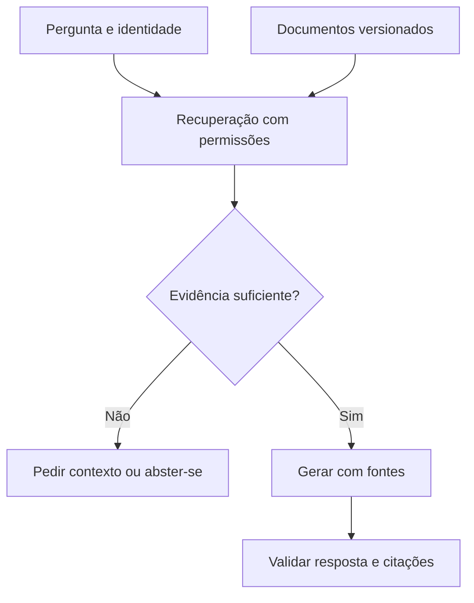
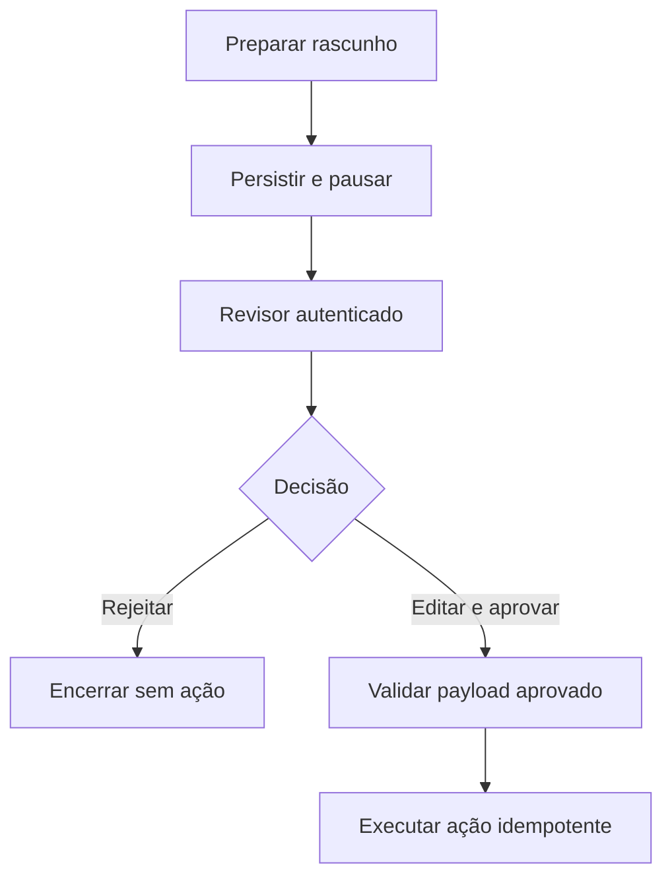

# Exemplos e arquiteturas

[← Voltar ao canivete](../README.md) · Revisão: 10/11/2026

Os 11 cenários do guia original continuam aqui. Quatro possuem código pequeno no diretório [exemplos](../exemplos/); os demais são receitas de arquitetura, sem promessa de implementação completa. Não há aplicação de produção pronta neste repositório.

## Configuração

Na raiz do repositório, em Linux/macOS:

```bash
python3 -m venv .venv
source .venv/bin/activate
python -m pip install -r exemplos/requirements.txt
python -m unittest discover -s tests -v
```

Requer Python 3.11+; a revisão foi verificada em Python 3.12. As dependências diretas estão fixadas; transitivas não estão totalmente travadas. No PowerShell, a ativação é `.venv\Scripts\Activate.ps1`.

Para exemplos que usam a OpenAI, defina `OPENAI_API_KEY` no ambiente local e `OPENAI_MODEL` com um ID disponível na sua conta. Não grave a chave no código ou no Git. Em bash, é possível digitá-la sem eco nem incluí-la no comando salvo pelo histórico:

```bash
read -rsp 'OPENAI_API_KEY: ' OPENAI_API_KEY
export OPENAI_API_KEY
read -rp 'OPENAI_MODEL (ID do catálogo): ' OPENAI_MODEL
export OPENAI_MODEL
```

RAG/streaming exigem modelo compatível com Responses; extração exige também structured outputs. Consulte o [catálogo](modelos-servicos.md) e o [guia de parâmetros](parametros.md). As chamadas reais podem gerar cobrança. Não há um modelo padrão escondido nos scripts.

**Escopo da verificação:** testes sem rede e sem credenciais reais verificam recuperação, abstenção sem contexto, serialização dos pedidos no SDK real com transporte simulado, pausa/retomada, rejeição, validação de campos e protocolo WebSocket. Não foi realizado benchmark, treinamento em GPU nem avaliação de qualidade de um modelo remoto.

## 1. RAG sobre documentos próprios

**Problema:** responder a dúvidas de suporte com base em informações da empresa.

**Implementação:** [rag.py](../exemplos/rag.py) e [base.py](../exemplos/base.py). A busca usa sobreposição lexical sobre dois documentos fictícios. Não implementa embeddings, BM25, banco vetorial ou controle de acesso: o objetivo é mostrar a fronteira entre recuperação e geração.

```bash
python -m exemplos.rag --somente-busca 'Como redefinir minha senha?'
python -m exemplos.rag 'Como redefinir minha senha?'
python -m exemplos.rag 'astronomia'
```

O primeiro comando consulta a base local, sem API. O segundo gera uma resposta com o contexto recuperado e pede citações. O terceiro retorna falta de contexto sem chamar o modelo. Uma resposta do modelo ainda precisa ser conferida: pedir citação não garante que a fonte sustente a frase.

Para uma base real: ingerir documentos, preservar origem/versão, aplicar permissões por usuário, dividir em chunks, indexar, recuperar candidatos e avaliar. Só acrescente reranking ou reescrita de consultas se houver ganho medido.



Fontes: [arquiteturas de recuperação](https://docs.langchain.com/oss/python/deepagents/retrieval), [Responses](https://developers.openai.com/api/docs/guides/text).

## 2. Fine-tuning com LoRA

**Caso de uso revisado:** classificar chamados internos ou padronizar respostas. O exemplo antigo de diagnóstico médico foi retirado porque atribuía probabilidade clínica sem calibração ou evidência.

**Receita, não script de treino validado:**

1. Definir a tarefa, o modelo base, a licença e uma métrica.
2. Separar treino/validação/teste e remover duplicatas/vazamento.
3. Medir baseline com prompt e, se pertinente, recuperação.
4. Preparar dataset no formato aceito pela versão do trainer, por exemplo registros `messages` com papéis e conteúdo.
5. Escolher Transformers/TRL com PEFT ou uma receita oficial de Unsloth/Axolotl.
6. Configurar módulos LoRA, rank, precisão, batch e checkpoints conforme modelo/hardware.
7. Treinar, comparar no teste separado e inspecionar regressões.
8. Publicar adaptador e artefatos com versões, licença e plano de rollback.

LoRA reduz parâmetros treináveis, mas não implica economia fixa, treino em poucas horas ou inferência abaixo de 100 ms. Fine-tuning de estilo não garante conhecimento factual atualizado.

Fontes: [TRL/SFT](https://huggingface.co/docs/trl/sft_trainer), [PEFT](https://huggingface.co/docs/peft/index), [Unsloth](https://docs.unsloth.ai/), [Axolotl](https://docs.axolotl.ai/).

## 3. Agentic RAG

**Caso:** uma pergunta exige política geral, exceções e data de vigência.

**Receita:** disponibilizar buscas como ferramentas; permitir ao agente selecionar consultas; limitar passos/custo; armazenar evidências; encerrar quando houver sustentação suficiente ou escalar quando faltar informação. Avalie também perguntas que não exigem ferramenta.

Um grafo fixo `retrieve → generate` é RAG em duas etapas, não se torna agentic só por usar LangGraph. O snippet antigo foi substituído por essa distinção. Para implementação, consulte [workflows e agentes](https://docs.langchain.com/oss/python/langgraph/workflows-agents).

## 4. Programação assistida por IA

**Caso:** desenvolver ou corrigir um serviço de consulta a documentos.

**Receita:** branch isolada, escopo e critérios claros, contexto do repositório, implementação em etapas, revisão do diff e testes relevantes. Use [Codex, Claude Code, Cursor ou alternativas](ferramentas.md#7-programação-assistida-por-ia) conforme ambiente e permissões.

Meça sucesso de tarefas e retrabalho; não prometa “5–10× mais rápido” ou um prazo fixo para qualquer aplicação. Agentes com shell precisam de permissões reais e revisão de comandos/efeitos externos.

## 5. Aplicação visual com Dify

**Caso:** equipe quer prototipar um assistente sobre documentos.

**Receita:** preparar base, configurar recuperação, definir modelo e instruções, montar fluxo, avaliar perguntas representativas e publicar com autenticação. Controle dados enviados ao provedor e custos do modelo. “Low-code” não elimina configuração, avaliação ou operação.

Referências: [Dify](https://docs.dify.ai/), [Langflow](https://docs.langflow.org/), [Flowise](https://docs.flowiseai.com/).

## 6. Custos e observabilidade

**Caso:** múltiplos modelos e aplicações sem visibilidade de gastos.

**Receita:** instrumentar chamadas e ferramentas; registrar modelo, tokens reportados, latência, status e identificador interno da tarefa; agregar custo por aplicação; definir orçamento, limites e alertas. Minimize ou mascare conteúdo sensível nos traces.

Use [Helicone AI Gateway](https://docs.helicone.ai/gateway/overview), [LiteLLM](https://docs.litellm.ai/), [Langfuse](https://langfuse.com/docs) ou a solução adequada ao ambiente. O snippet de proxy legado do Helicone foi retirado; novas integrações devem seguir a documentação do gateway e do endpoint escolhido. Preços estimados precisam ser reconciliados com a cobrança real.

## 7. Human-in-the-loop e handoff

**Caso:** revisar uma resposta ou ação antes de prosseguir.

**Código:** [revisao_humana.py](../exemplos/revisao_humana.py), usando `StateGraph`, `InMemorySaver`, `interrupt()` e `Command(resume=...)`.

```bash
python -m exemplos.revisao_humana
```

A execução pausa com o rascunho e retoma com uma decisão simulada que edita/aprova o texto. Os testes cobrem também rejeição e isolamento entre threads. O script não envia mensagem nem se conecta ao WhatsApp.



Em produção, substitua memória por checkpoint durável, autentique o aprovador e vincule a decisão ao payload. O nó reinicia ao retomar: efeitos anteriores ao `interrupt()` podem repetir. Integração com WhatsApp exige webhook, API oficial, identidade, persistência e política de handoff; isso não está implementado aqui.

Fonte: [LangGraph interrupts](https://docs.langchain.com/oss/python/langgraph/interrupts).

## 8. Extração estruturada de documentos

**Caso:** extrair itens de uma nota fictícia sem inventar campos.

**Código:** [extracao.py](../exemplos/extracao.py), com `OpenAI.responses.parse` e `BaseModel` do Pydantic.

```bash
python -m exemplos.extracao
```

O input do exemplo é texto, não PDF. Número e total podem ser nulos quando ausentes. Quantidades/preços têm restrições; a soma é conferida com `Decimal`. Não há frete, imposto ou desconto nesse schema simplificado. Uma nota real exige regras adicionais e evidências por campo.

Para PDF: use conversão/OCR ou o suporte nativo de arquivos do modelo; mantenha número da página e trechos de origem. Recusa, truncamento, schema inválido e divergência de totais devem gerar tratamento/revisão, não inserção automática no ERP. Instructor é uma alternativa de integração, conforme [documentação](https://python.useinstructor.com/).

Fontes: [structured outputs](https://developers.openai.com/api/docs/guides/structured-outputs), [validadores Pydantic](https://docs.pydantic.dev/latest/concepts/validators/).

## 9. Workflow de pesquisa, escrita e revisão

**Caso:** produzir um artigo técnico com fontes verificáveis.

**Receita:** pesquisador entrega fontes/trechos; redator usa apenas evidências aprovadas; revisor confere afirmações; um limite encerra o ciclo de revisão. Preserve proveniência, contradições e pendências. A revisão pode ser feita por funções, etapas de um workflow ou agentes distintos.

Use CrewAI/LangGraph quando a divisão trouxer ganho mensurável. Vários agentes não garantem independência factual nem qualidade maior que um fluxo simples. Consulte [CrewAI](https://docs.crewai.com/) e [LangGraph](https://docs.langchain.com/oss/python/langgraph/overview).

## 10. Busca híbrida com grafo opcional

**Caso:** combinar significado, identificadores exatos e relações.

**Receita:** indexar texto/metadados; buscar em índices lexical e vetorial; aplicar filtros de autorização; fundir resultados; reranquear; enviar evidências para geração. Acrescente grafo apenas quando as relações ajudarem a tarefa.

Não some scores brutos de escalas distintas. RRF é uma alternativa de fusão; pesos e número de candidatos precisam de avaliação. Grafo pode complementar a recuperação, mas não é requisito de todo RAG híbrido.

Fonte: [consultas híbridas no Qdrant](https://qdrant.tech/documentation/concepts/hybrid-queries/), [GraphRAG](https://microsoft.github.io/graphrag/).

## 11. RAG com streaming e WebSocket

**Código:** [streaming.py](../exemplos/streaming.py).

```bash
python -m uvicorn exemplos.streaming:app --host 127.0.0.1 --port 8000
```

Conecte um cliente WebSocket a `ws://127.0.0.1:8000/ws/chat` e envie uma pergunta como texto. O servidor responde com JSONs de `tipo=texto`, `tipo=fim` ou `tipo=erro`. Não há página de chat embutida. Use `Ctrl+C` para parar o servidor.

A busca ocorre **antes** da geração: o modelo precisa das evidências para fundamentar a resposta. Depois, a saída é transmitida incrementalmente. Isso corrige a alegação antiga de que busca e geração fundamentada aconteceriam simultaneamente sem dependência.

O exemplo trata desconexão, pergunta vazia/grande, falta de contexto e falhas do provedor. Não implementa autenticação, rate limiting, histórico ou deploy público: execute no loopback. Cada pergunta é independente. Streaming reduz espera percebida, mas não garante menor tempo total nem resposta instantânea.

Fontes: [FastAPI WebSockets](https://fastapi.tiangolo.com/advanced/websockets/), [Responses streaming](https://developers.openai.com/api/docs/guides/streaming-responses).
